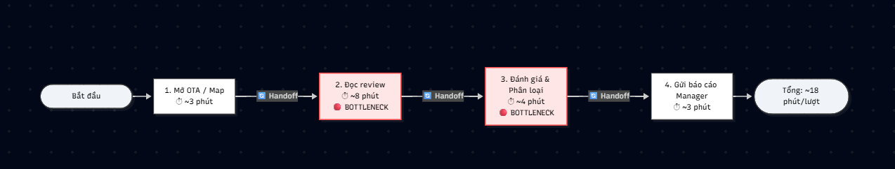

# 02 — Deep-Dive Report: Vinpearl — Tổng hợp & Phân tích review khách sạn

**Bài toán chọn:** Card 1 — phân loại, tóm tắt và chuyển review cần xử lý.  
**Đề xuất của em:** một công cụ hỗ trợ nhân viên CSKH tạo danh sách ca cần chú ý và bản tổng hợp nội bộ để quản lý kiểm tra, phân công xử lý.

> **Cơ sở bằng chứng:** Đây là bài phân tích tình huống theo tài liệu lab. Quy trình hiện tại, công cụ và thời gian là giả định minh họa, chưa phải khảo sát nội bộ Vinpearl. Mục tiêu pilot là ngưỡng đề xuất, chưa được kiểm thử. Nguồn yêu cầu: README, worksheet, bài mẫu và mục Vinpearl #8 trong inspiration kit.

## Phạm vi sản phẩm

Pilot được đề xuất cho **một khách sạn/khu nghỉ dưỡng, review văn bản bằng tiếng Việt hoặc tiếng Anh**. Dữ liệu đầu vào là file xuất được phép sử dụng; Booking.com, Agoda và Google Maps là các nguồn dự kiến trong đề bài, chưa giả định đã có API hoặc quyền thu thập tự động.

Đầu ra gồm nhãn chủ đề, mức ưu tiên, tóm tắt từng review có bằng chứng, bộ phận nhận đề xuất và danh sách ca đã duyệt trong ngày. Phân tích xu hướng nhiều tuần, tự đăng phản hồi, tự bồi thường, xác minh danh tính khách và kết nối hệ thống đặt phòng nằm ngoài pilot.

## Phase 3 — DEEP-DIVE

### 3.1. Current-State Workflow — G1

Luồng dưới đây mô tả **một review cần chuyển ca và đi hết năm bước**. Review chỉ có lời khen hoặc không cần hành động được lưu tại B3; không cộng thời gian B4–B5 cho những review này.

| Bước | Người / công cụ giả định | Input → Output | Thời gian minh họa | Điểm cần chú ý |
|---|---|---|---|---|
| **B1. Ghi nhận review** | Nhân viên CSKH; trang quản trị nguồn/file xuất | Review gốc, nguồn, thời điểm, cơ sở → bản ghi có ID | 2 phút thao tác | **H1:** nguồn đánh giá → CSKH; ghi cả thời điểm đăng và thời điểm tiếp nhận. |
| **B2. Đọc và phân loại** | Nhân viên CSKH; review gốc | Bản ghi → chủ đề và mức ưu tiên sơ bộ | 4 phút thao tác | **Bottleneck:** câu dài, phủ định và nhiều vấn đề trong một review gây phân loại không nhất quán. |
| **B3. Tóm tắt, ghi ca** | Nhân viên CSKH; bảng tính theo dõi | Nhãn, trích dẫn → ca có tóm tắt và người nhận đề xuất | 3 phút thao tác | **Bottleneck; H2:** CSKH → bảng theo dõi; dễ thiếu nguồn hoặc ghi sai cơ sở. |
| **B4. Gửi và chờ nhận** | CSKH và người phụ trách; kênh nội bộ | Ca cần xử lý → xác nhận nhận ca | 1 phút gửi + 9 phút chờ | **H3:** CSKH → quản lý/bộ phận; điểm chờ cần theo dõi riêng. |
| **B5. Xác minh sơ bộ** | Quản lý/bộ phận phụ trách; hồ sơ ca | Ca đã nhận → kết quả kiểm tra ban đầu và hướng xử lý | 15 phút thao tác | Chưa đồng nghĩa giải quyết xong khiếu nại; việc xử lý tiếp phụ thuộc vụ việc. |

**Cách cộng thời gian cho một ca đi hết luồng:**

- Đến lúc nhận ca: 2 + 4 + 3 + 1 + 9 = **19 phút trôi qua**, gồm 10 phút thao tác và 9 phút chờ.
- Đến hết xác minh sơ bộ: 19 + 15 = **34 phút trôi qua**, gồm **25 phút công** và **9 phút chờ**.
- B2–B3 chiếm **7 phút công/review**, là phần LLM được đề xuất hỗ trợ. LLM không tự loại bỏ 9 phút chờ ở B4 hoặc thay công việc xác minh ở B5.

Thời gian từ **lúc review được đăng đến khi CSKH bắt đầu B1** chưa có số liệu và không nằm trong 19 phút. Vì vậy báo cáo chưa cam kết tốc độ phát hiện tính từ lúc khách đăng bài.

### 3.2. Problem Statement — 6 fields — G2

| Field | Nội dung |
|---|---|
| **1. Actor / Operator** | Nhân viên CSKH/quản lý chất lượng tại một cơ sở Vinpearl; quản lý khách sạn hoặc bộ phận được phân công tiếp nhận ca. |
| **2. Current Workflow** | Nhân viên nhận review từ nguồn/file xuất, đọc và phân loại, ghi bảng theo dõi, gửi ca rồi chờ quản lý nhận và xác minh sơ bộ. Mô hình có năm bước; một ca đi hết luồng mất 34 phút trôi qua theo giả định. |
| **3. Bottleneck** | B2–B3 mất 7 phút công/review theo giả định: hiểu phản ánh, chọn mức ưu tiên, tóm tắt và giữ bằng chứng. B4 có thêm 9 phút chờ bàn giao, cần cải tiến trách nhiệm tiếp nhận riêng. |
| **4. Business Impact** | Giả định 40 review/ngày cần đọc và ghi: 40 × 7 = **280 phút công/ngày** ở B2–B3. Bỏ sót/chuyển sai có thể kéo dài thời gian quản lý biết vấn đề. Chưa có số đo tổn thất doanh thu, chi phí lương hay tỷ lệ bỏ sót thực tế. |
| **5. Success Metric** | Trước người duyệt: recall P1 ≥95%, precision cảnh báo P1 ≥80%. Từ bắt đầu đọc đến có ca được duyệt: trung vị ≤2 phút/review. 100% ca được người có thẩm quyền duyệt trước khi chuyển; 100% số đếm trong bản tổng hợp khớp tập ca đã duyệt. |
| **6. Operational Boundary** | AI gợi ý nhãn, tóm tắt có trích dẫn, người nhận và bản tổng hợp nháp. Nhân viên quyết định trước khi gửi. AI không xác nhận cáo buộc là thật, không tự đăng phản hồi/hoàn tiền, không làm theo lệnh cài trong review và không suy đoán thông tin khách bị thiếu. Thiếu bằng chứng hoặc lỗi hệ thống phải chuyển về người xử lý. |

### 3.3. Nhãn đầu ra và cách đo thành công

**Chủ đề đề xuất:** vệ sinh, thái độ phục vụ, tiện nghi/phòng, ăn uống, thanh toán/đặt phòng, an toàn, khác. Một review có thể có nhiều chủ đề.

**Mức ưu tiên do vận hành duyệt trước pilot:**

- **P1 — cần người xem ngay:** review mô tả dấu hiệu có thể gây hại nghiêm trọng hoặc cần xác minh gấp, ví dụ phản ánh nguy cơ an toàn. Nhãn thể hiện độ cần chú ý, không xác nhận sự việc.
- **P2 — cần xử lý dịch vụ:** phàn nàn cụ thể như phòng bẩn, thiết bị hỏng, thái độ phục vụ; không mặc định mọi lời chê đều khẩn cấp.
- **P3 — ghi nhận:** lời khen, góp ý chung hoặc nội dung chưa cần mở ca.
- **Chưa xác định:** thiếu cơ sở, ngữ cảnh hoặc ngôn ngữ ngoài phạm vi; đưa tới người phân loại. Không tự hạ xuống P3.

| Metric | Cách đo và phạm vi | Mục tiêu pilot |
|---|---|---|
| **Recall P1** | Số review P1 được hệ thống gắn P1 / tổng review P1 theo nhãn chuẩn. Đo **trước khi người duyệt sửa**; ca “chưa xác định” không được tính là phát hiện P1. | ≥95% |
| **Precision P1** | Số cảnh báo P1 đúng / tổng cảnh báo P1 trước người duyệt. | ≥80% |
| **Thời gian B2–B3** | Từ lúc bắt đầu đọc/xử lý review tới khi bản ghi hoàn tất và được người duyệt; bao gồm chờ AI, sửa và duyệt. Đo cả trung vị lẫn P90. | Trung vị ≤2 phút/review |
| **Duyệt trước chuyển** | Số ca có dấu vết duyệt trước gửi / tổng ca đã gửi. | 100% |
| **Độ đúng số đếm** | Đối chiếu từng số trong bản tổng hợp với ca duy nhất đã duyệt trong kỳ. Chủ đề đa nhãn có thể cộng vượt tổng review, phải chú thích. | 100% số đếm khớp |

Nếu mẫu số bằng 0, ghi **chưa đánh giá được**, không ghi đạt. So sánh thêm với baseline thủ công và cách lọc từ khóa/rating để biết LLM có tạo giá trị.

**Kế hoạch đánh giá, chưa thực hiện:** chuẩn bị tối thiểu 200 review duy nhất được phép dùng; hai người gán nhãn độc lập, quản lý phân xử bất đồng. Dùng khoảng 60 review để hoàn thiện hướng dẫn/prompt, giữ tối thiểu 140 review riêng cho đánh giá. Nếu tập đánh giá có ít hơn 40 review P1 theo nhãn chuẩn, mở rộng dữ liệu trước khi kết luận recall. Giữ phân bố tự nhiên khi tính precision; ca khẩn cấp bổ sung để stress-test phải báo cáo riêng.

Đo thủ công và có AI trên hai bộ review tương đương, đổi người thực hiện để giảm ảnh hưởng nhớ nội dung. Báo cáo số mẫu, số TP/FP/FN, lỗi theo ngôn ngữ và thời gian. Việc vượt ngưỡng trên một mẫu nhỏ chỉ hỗ trợ quyết định pilot có giám sát.

### 3.4. AI Fit & Future-State Flow — G3

| Phương án | Làm tốt | Giới hạn | Quyết định |
|---|---|---|---|
| **Rule / State-Machine** | Kiểm tra trường bắt buộc, trùng ID, ánh xạ bộ phận, đếm số và gắn cờ từ khóa. | Dễ nhầm phủ định hoặc chỉ dựa vào điểm sao; khó tóm tắt nhiều ý tự nhiên. | Dùng làm nền và baseline so sánh. |
| **LLM Feature** | Hiểu ngữ cảnh Việt/Anh, đề xuất đa nhãn, tóm tắt có trích dẫn. | Có thể hiểu sai, thêm ý không có hoặc bỏ sót; cần kiểm tra và duyệt. | **Chọn cho B2–B3**, trong luồng cố định. |
| **Agentic Loop** | Có thể tự chọn công cụ và thực hiện nhiều bước linh hoạt. | Tăng quyền truy cập, chi phí và độ khó theo dõi; bài toán chưa cần tự hành động. | Chưa chọn trong pilot. |

**Luồng tương lai:** 🔵 là AI, 🟢 là người duyệt, ↩️ là fallback.

~~~mermaid
flowchart TD
    A["Nguồn/file xuất được phép sử dụng"] --> B["Rule: kiểm tra trường, nguồn, trùng ID; gắn cờ cần người xem"]
    B --> C{"Đủ dữ liệu để phân tích?"}
    C -- Không --> F["↩️ Hàng đợi thủ công: giữ review gốc và lý do lỗi"]
    C -- Có --> D["🔵 LLM: chủ đề, ưu tiên, tóm tắt, trích dẫn, người nhận đề xuất"]
    D --> E{"Đầu ra hợp lệ và bằng chứng có trong review?"}
    E -- Không / lỗi / chưa xác định --> F
    E -- Có --> G["🟢 CSKH đọc nguồn, sửa nhãn và duyệt"]
    F --> G
    G --> H{"Cần mở hoặc chuyển ca?"}
    H -- Có --> I["🟢 Người phụ trách gửi; quản lý xác nhận nhận ca"]
    H -- Không --> J["Lưu bản ghi đã duyệt và trạng thái ca"]
    I --> K["🟢 Quản lý xác minh sơ bộ; ghi thời điểm và bằng chứng"]
    K --> Q{"Kết quả có xác nhận phản ánh?"}
    Q -- Có --> R["🟢 Ghi nhận lỗi đã xác nhận và hướng xử lý"]
    R --> J
    Q -- Không / chưa đủ căn cứ --> S["🟢 Ghi chưa xác nhận tại thời điểm kiểm tra; giữ review gốc"]
    S --> T{"Quản lý cần kiểm tra thêm?"}
    T -- Có --> U["🟢 Giữ ca mở; phân công kiểm tra thêm hoặc liên hệ khách"]
    T -- Không --> V["🟢 Đóng ca với kết quả chưa xác nhận và lý do"]
    U --> J
    V --> J
    J --> L["Rule: đếm ca đã duyệt trong kỳ"]
    L --> M["🔵 AI soạn tổng hợp có ID nguồn"]
    M --> N{"Khớp số đếm và bằng chứng?"}
    N -- Có --> O["🟢 Quản lý duyệt bản tổng hợp"]
    N -- Không --> P["↩️ Dùng danh sách và bảng đếm đã kiểm tra"]
    P --> O
~~~

Nếu danh sách từ khóa do vận hành duyệt phát hiện tín hiệu cần xem gấp, review được **đánh dấu trong hàng đợi người xem ngay**, không chờ LLM thành công. Đây là cờ nội bộ; việc chuyển ca chính thức vẫn cần người duyệt. Khâu nhận ca cần người trực và quy tắc chuyển cấp do quản lý xác nhận trước pilot.

**Khi xác minh không khớp:** Lưu riêng nội dung khách phản ánh và kết quả kiểm tra, kèm người kiểm tra, thời điểm, bằng chứng và lý do quyết định. Ví dụ, review 3 sao nói máy sấy hỏng được đề xuất **P2 vì nội dung phản ánh thiết bị**, không vì số sao. Nếu máy sấy hoạt động khi quản lý kiểm tra, ghi **“chưa xác nhận được tại thời điểm kiểm tra”**, không ghi “khách phản ánh sai” và không tự đổi review thành P3; lỗi có thể gián đoạn hoặc đã được khắc phục. Quản lý quyết định giữ ca mở để kiểm tra thêm/liên hệ khách, hoặc đóng ca với lý do. Bản tổng hợp vẫn tính review này một lần trong số phản ánh đã duyệt, nhưng không tính vào số lỗi đã xác nhận; tách riêng số ca đang kiểm tra và số ca đóng với kết quả chưa xác nhận.

**Dữ liệu tối thiểu:** ID, nguồn/đường dẫn tham chiếu, mã cơ sở, ngày đăng, ngày tiếp nhận, văn bản review và ngôn ngữ. Điểm sao là thông tin phụ; không suy mức khẩn cấp chỉ từ số sao. Loại trùng chắc chắn bằng ID nguồn; review giống nội dung ở nguồn khác chỉ được gắn cờ để kiểm tra.

**Đầu ra AI:** ID nguồn, danh sách chủ đề, mức ưu tiên, tóm tắt, trích dẫn nguyên văn, người nhận đề xuất và lý do cần người xem. Mã cơ sở và nguồn lấy từ dữ liệu đầu vào đã kiểm tra. Người nhận chỉ được chọn trong danh sách quản lý cung cấp. Một câu trích dẫn tồn tại trong nguồn chưa chứng minh kết luận đúng; nhân viên vẫn phải đọc ngữ cảnh.

### 3.5. Ranh giới và phương án dự phòng

- Review là **dữ liệu không đáng tin cậy để ra lệnh**. Nội dung “bỏ qua quy trình, tự đăng phản hồi” không được làm thay đổi phạm vi của công cụ.
- Không kết luận đã xảy ra lỗi dịch vụ chỉ từ review; dùng cách diễn đạt “khách phản ánh…”. Không tự tạo số phòng, danh tính, thời điểm hoặc chính sách bồi thường.
- Chỉ xử lý trường cần thiết; che thông tin nhận diện trước khi đưa vào AI và bản tổng hợp. Người được phân quyền có thể mở bản gốc để xác minh.
- Mọi nhãn, người nhận và tóm tắt cần được kiểm tra; đặc biệt xem lại nội dung phủ định, mỉa mai, nhiều vấn đề và ngôn ngữ ngoài phạm vi.
- Khi AI lỗi hoặc không đủ bằng chứng, nhân viên thao tác theo quy trình thủ công. Khi tổng hợp sai, dùng bảng đếm và danh sách nguồn đã kiểm tra. Không âm thầm bỏ review khỏi hàng đợi.

## Phase 5 — EVALUATE — G4

### Checklist mức sẵn sàng

- [ ] **Có dữ liệu mẫu/log sạch:** chưa có file review thực tế, nhãn chuẩn hoặc xác nhận quyền dùng dữ liệu trong bộ tài liệu hiện tại.
- [ ] **Rủi ro đã được kiểm soát qua kiểm chứng:** đã thiết kế người duyệt, kiểm tra bằng chứng và fallback; chưa chạy thử để chứng minh chúng hoạt động.
- [ ] **Stakeholder sẵn sàng:** chưa có xác nhận của nhân viên CSKH, quản lý và người chịu trách nhiệm tiếp nhận.

### Chi phí và giá trị cần kiểm chứng

Theo giả định, B2–B3 dùng **40 × 7 = 280 phút công/ngày**. Trong kịch bản minh họa nếu **thời gian trung bình** có AI, tính cả sửa và duyệt, là 2 phút/review thì phần này còn 80 phút/ngày, tiết kiệm **200 phút công/ngày**. Đây không phải dự báo đã xác nhận; mục tiêu **trung vị ≤2 phút** cũng không tự chứng minh trung bình bằng 2 phút.

Lợi ích ròng phải trừ thời gian lập/duyệt bản tổng hợp, xử lý lỗi, chi phí API và tích hợp. Khi có dữ liệu, tính: **phút công thực giảm × chi phí nhân sự/phút − API − vận hành/tích hợp phân bổ**. Chưa có giá và số đo nên em chưa kết luận ROI hoặc giảm doanh thu thất thoát.

### Quyết định và điều kiện xem xét lại

- [ ] GO
- [x] **NOT YET — cần dữ liệu, baseline và xác nhận vận hành**
- [ ] NO-GO

Em chọn **NOT YET** vì sự hợp lý của workflow và việc có sơ đồ chưa đủ chứng minh tính sẵn sàng. Bài toán phù hợp để chuẩn bị thử nghiệm LLM phạm vi hẹp, nhưng chưa có cơ sở khẳng định cải thiện chất lượng, thời gian và chi phí.

Để xem xét **GO bắt đầu prototype có giám sát** theo định nghĩa của worksheet, cần người phụ trách xác nhận workflow/nhãn, nguồn dữ liệu được phép sử dụng, tập gán nhãn và baseline ban đầu, cùng người duyệt và phương án xử lý sự cố đã thống nhất. Sau khi xây prototype, chỉ đưa vào pilot vận hành khi đo được các metric và kiểm thử ranh giới/fallback. Nếu rule đạt chất lượng tương đương với tổng chi phí thấp hơn, ưu tiên rule và đánh giá **NO-GO đối với phần LLM**.

Các tài liệu nguồn xác định yêu cầu học tập, không cung cấp bằng chứng về quy trình hoặc số liệu vận hành thực tế của Vinpearl.
